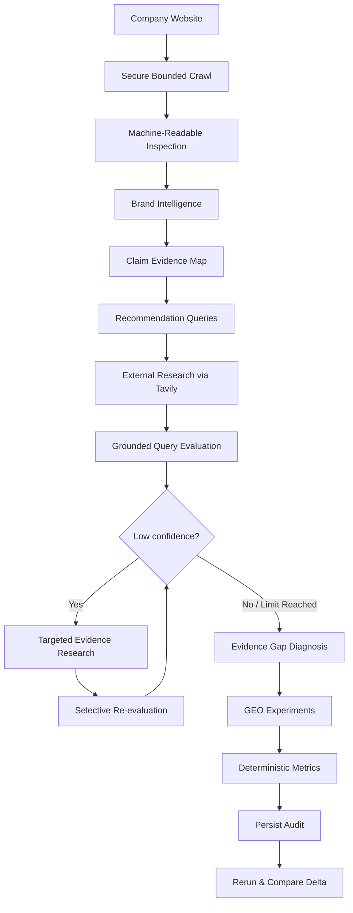

# AnswerLens

**AI Brand Evidence & GEO Readiness Agent**

AnswerLens is an agentic GEO auditing application that analyzes a company's public web presence, builds a source-grounded model of what the brand can credibly claim, evaluates its readiness across realistic recommendation queries, identifies evidence gaps, proposes measurable GEO experiments, and tracks improvement across reruns.

It evaluates **publicly available evidence readiness** — it does not pretend to reproduce proprietary rankings or exact answers from ChatGPT, Claude, Gemini, or Perplexity.

---

## How it works



The LangGraph workflow is deliberately bounded: additional evidence research can run for at most two rounds, and provider-unavailable evaluations do not enter an uncontrolled retry loop.

---

## What AnswerLens analyzes

- Public website content and structured data
- `robots.txt`, sitemaps, `llms.txt`, and JSON-LD
- Brand positioning, audiences, capabilities, use cases, and claims
- Explicit evidence supporting or contradicting candidate claims
- Buyer-style recommendation queries
- Independent web evidence and competitors
- Query-level evidence readiness and confidence
- Evidence gaps and measurable GEO experiments
- Baseline → rerun → delta progress

### Core metrics

- **Evidence Coverage**
- **Query Readiness**
- **Strong Queries**
- **Evidence Gaps**
- **External Evidence Diversity**

AnswerLens intentionally does not manufacture a proprietary “ChatGPT score.”

---

## Engineering highlights

- **Real LangGraph agent workflow** with conditional evidence research
- **Grounded AI outputs** validated through strict Pydantic contracts
- **Source validation** for evidence URLs, excerpts, ownership, claims, and competitors
- **Secure crawler** with SSRF protections, public-IP validation, bounded redirects, timeouts, and response limits
- **Prompt-injection boundaries** treating crawled and retrieved content as untrusted data
- **Bounded execution** across crawl pages, queries, search results, research rounds, experiments, and total audit time
- **PostgreSQL / Neon persistence** with immutable audit history
- **Baseline, rerun, and deterministic delta comparison**
- **Safe provider failure handling** without fabricated results or leaked provider details

---

## Stack

**Frontend:** Next.js · React · TypeScript · Tailwind CSS

**Backend:** Python · FastAPI · Pydantic

**Agents:** LangGraph · Gemini 3.6 Flash

**Research:** Tavily Search API

**Database:** PostgreSQL / Neon

**Testing:** Pytest · Vitest · React Testing Library

---

## Run locally

### Prerequisites

- Node.js 20.9+
- Python 3.11+
- PostgreSQL or Neon database
- Gemini API key
- Tavily API key

Configure the environment variables documented in `.env.example`.

Never commit real `.env` files or credentials.

### Backend

```bash
cd backend

python -m venv .venv
python -m pip install -r requirements-dev.txt
python db/migrate.py
uvicorn main:app --reload
```

API:

```text
http://localhost:8000
```

Health check:

```text
GET /health
```

### Frontend

```bash
cd frontend

npm install
npm run dev
```

Application:

```text
http://localhost:3000
```

---

## Verification

Backend:

```bash
cd backend
python -m pytest -q
python -m pip check
```

Frontend:

```bash
cd frontend
npm run lint
npm run test
npm run build
```

Automated integration tests exercise the real application workflow while replacing only external/non-deterministic boundaries with deterministic test implementations.

---

## Repository docs

For deeper technical detail:

- [`docs/ARCHITECTURE.md`](docs/ARCHITECTURE.md) — architecture and safety boundaries
- [`docs/AGENT_WORKFLOW.md`](docs/AGENT_WORKFLOW.md) — LangGraph execution model
- [`docs/EVALS.md`](docs/EVALS.md) — evaluation methodology and metrics
- [`docs/GEO_ASSUMPTIONS.md`](docs/GEO_ASSUMPTIONS.md) — GEO interpretation boundaries
- [`docs/CODING_AGENT_RUNS.md`](docs/CODING_AGENT_RUNS.md) — implementation, testing, and human-review history
- [`docs/PROJECT_SPEC.md`](docs/PROJECT_SPEC.md) — finalized product specification

---

## Design principle

> **Evidence before inference.**

AnswerLens keeps publisher claims, independent evidence, model reasoning, and application-owned validation separate so unsupported assumptions cannot silently become facts.
